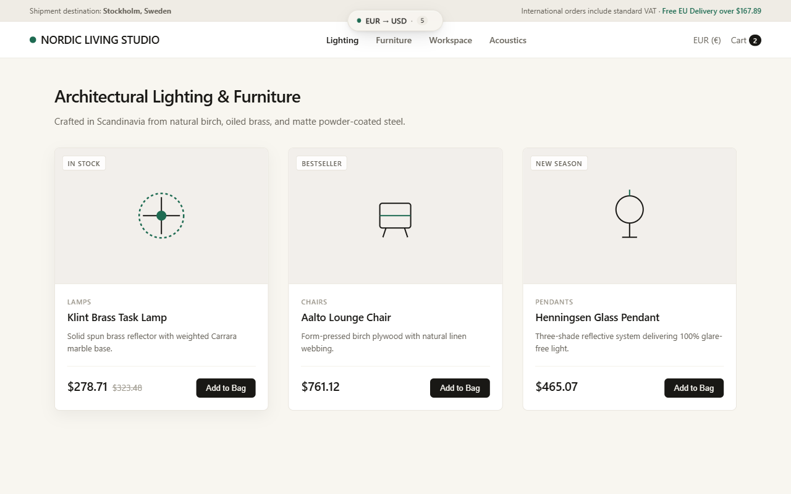
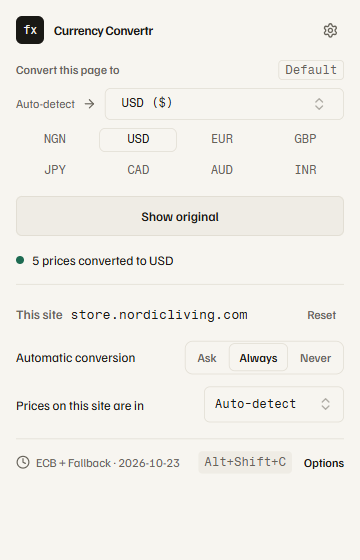
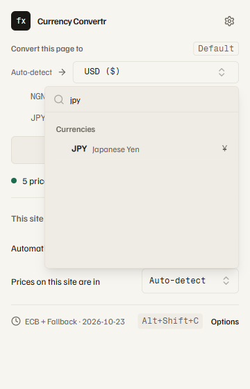
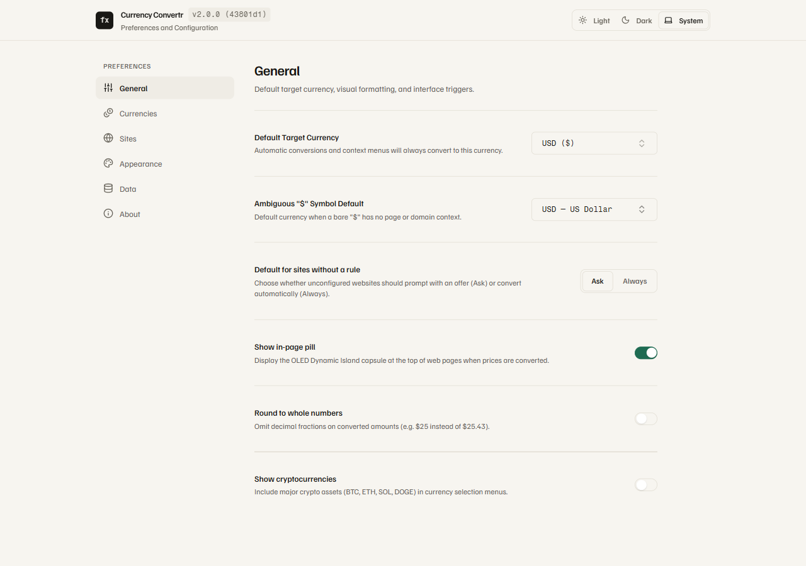
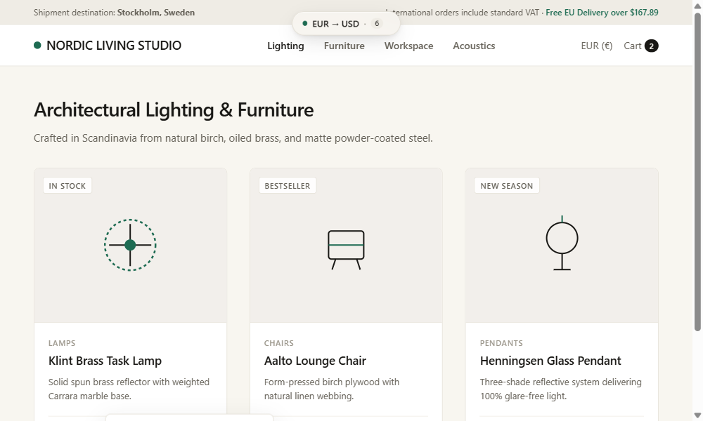
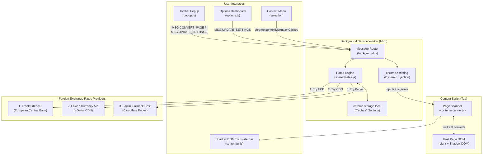

# Currency Convertr

[](package.json)
[](https://developer.chrome.com/docs/extensions/mv3/intro/)
[](LICENSE)
[](#cross-browser-compatibility)
[](#testing--verification)

> **"Google Translate for prices"** (v2.0.0) — A privacy-first browser extension that converts prices on international web pages into your preferred currency in place, with a floating status pill and instant restoration of original prices.

---

## Visual Tour

### 1. In-Page Dynamic Island & Price Translation
Prices convert directly on the page without jumping or layout reflows. An elegant, non-intrusive floating Dynamic Island capsule lets you toggle conversion, inspect active status, and switch target currencies directly on page. Hovering over any converted price displays a detailed tooltip showing the original price and the exact exchange rate used.



### 2. Action Popup with Searchable Combobox
Quickly trigger conversion on the active page, switch between pinned target currencies or search across 170+ global fiat and cryptocurrencies with the keyboard-friendly combobox, and configure per-site auto-conversion rules.

| Action Popup (Light) | Quick Currency Search |
|:---:|:---:|
|  |  |

### 3. Full Preferences & Options Dashboard
Customize your default target currency, manage up to 8 pinned currencies for quick access, select your preferred display mode (`Replace`, `Append`, or `Replace + Highlight`), toggle cryptocurrency support, and manage per-site auto-conversion rules.



### 4. Right-Click Selection Conversion
Highlight any specific price string, right-click, and convert it instantly via a native desktop notification.



---

## Core Features

- **In-Place Page Conversion**: Converts every detected price on any page into your chosen currency without disrupting page layout.
- **Three Display Modes**:
  - `Replace` (Default): Cleanly replaces the price on page; hover tooltip displays original amount.
  - `Append`: Displays original and converted prices side-by-side (e.g. `$20.00 (≈ ₦30,512)`).
  - `Replace + Highlight`: Adds a subtle, elegant highlight to converted prices.
- **100% Byte-for-Byte Reversible**: Preserves exact original text nodes and DOM structures in memory (`WeakMap<Element, DocumentFragment>`). Clicking "Show original" restores the page to its pristine state.
- **Split-Price Assembly**: Intelligently handles modern e-commerce layouts (such as Amazon's split symbol, whole, and fraction tags, `<sup>` cents, and nested spans) as cohesive pricing units.
- **Dynamic Content & SPAs**: Batched `MutationObserver` automatically converts new items loaded via infinite scroll or client-side navigation without main-thread blocking or infinite loops.
- **Open Shadow DOM Support**: Traverses open shadow roots in modern web components to convert encapsulated pricing elements.
- **Smart Currency Detection**:
  1. Unambiguous tokens (`US$`, `CA$`, `AU$`, `NZ$`, `₦`, `€`, `zł`, `Kč`, `฿`, `₺`, etc.).
  2. Structured page metadata (JSON-LD `priceCurrency`, `og:price:currency`, `product:price:currency`, and microdata `[itemprop="priceCurrency"]`).
  3. Site context: Country-code TLD mapping (.ca &rarr; CAD, .co.uk &rarr; GBP, .ng &rarr; NGN, .jp &rarr; JPY, etc.) and `<html lang>` region codes.
  4. Per-site user overrides.
  5. Configurable default for ambiguous symbols (`$`, `¥`, `kr`).
- **170+ Global Currencies**: Full support for 162 ISO 4217 currencies plus major cryptocurrencies with localized minor-unit precision and rounding options.
- **3-Tier Rates Engine**:
  - Primary: European Central Bank (ECB) via Frankfurter API.
  - Secondary: Fawaz Ahmed Currency API via jsDelivr CDN.
  - Tertiary: Fawaz Ahmed Currency API via Cloudflare Pages.
  - Transparent cross-rates calculated through EUR with a 6-hour cache, stale-while-revalidate, in-flight deduplication, and offline fallback.
- **Zero Runtime Dependencies in Core Engine**: The in-page DOM scanner, background service worker, and Shadow DOM Dynamic Island pill are built entirely in vanilla JavaScript with zero framework overhead. Extension surfaces (Options and Popup) use locally bundled React and shadcn/ui components with 100% local bundling (zero remote scripts, zero CDN calls).

---

## Architecture Overview



---

## Permission Model & Least Privilege

Currency Convertr requests the following permissions in `manifest.json`:

| Permission | Scope | Technical Justification |
|---|---|---|
| `contextMenus` | API | Enables the right-click "Convert prices on this page" context menu item. |
| `notifications` | API | Displays quick conversion notifications for right-click text selections. |
| `storage` | API | Persists user preferences and cached exchange rate tables locally (`chrome.storage.local` and `chrome.storage.session`). |
| `activeTab` | API | Grants temporary access to the active tab to execute in-page conversion on user demand. |
| `scripting` | API | Executes content script injection into active tabs upon conversion request. |
| `tabs` | API | Queries active tab properties (URL, domain) to verify restricted schemes and determine whether automated site rules apply to the active page. |
| `<all_urls>` | Host Permission | Required to scan and convert currency prices across international shopping websites, and fetch public ECB reference rates. |

---

## Installation & Local Development

### Prerequisites
- Node.js v18.0.0 or higher
- Google Chrome, Microsoft Edge, Brave, or Mozilla Firefox
- Playwright Chromium (for E2E browser tests): `npx playwright install chromium`

### 1. Build the Extension
> **Important**: `dist/` is not tracked in git. You must run `npm run build`, then load `dist/chrome`.

```bash
# Clone the repository
git clone https://github.com/richmondsogo/currency-convertr.git
cd currency-convertr

# Install dependencies
npm install

# Install Playwright browser for E2E tests
npx playwright install chromium

# Compile Chrome and Firefox distribution bundles (run npm run build, then load dist/chrome; dist/ is not tracked)
npm run build
```

### 2. Load into Chromium (Chrome, Edge, Brave)
1. Open your browser and navigate to `chrome://extensions/` (or `edge://extensions/`).
2. Toggle **Developer mode** on in the top-right corner.
3. Click **Load unpacked**.
4. Select the `dist/chrome` folder (run `npm run build` first; `dist/` is not tracked).

### 3. Load into Mozilla Firefox
1. Open Firefox and navigate to `about:debugging#/runtime/this-firefox`.
2. Click **Load Temporary Add-on...**.
3. Select `dist/firefox/manifest.json` (run `npm run build` first; `dist/` is not tracked).

---

## Testing & Verification

The repository includes both unit tests and a real-browser Playwright E2E harness:

```bash
# Run unit and DOM integration tests
npm test

# Run real-browser E2E tests (Chrome for Testing)
npm run test:e2e

# Lint Firefox extension for Mozilla AMO compliance
npm run lint:firefox
```

---

## Privacy Policy Summary

- **Local-Only Processing**: All webpage text inspection, candidate price detection, and DOM scanning occur strictly on your device inside volatile memory. Nothing about your browsing history, page contents, or URLs is ever recorded, transmitted, or shared.
- **On-Demand Execution**: Content scripts are injected only on user demand or for sites you explicitly set to "Always convert". No scripts passively monitor your browsing on unconfigured sites.
- **Zero Telemetry**: No analytics beacons, no crash tracking SDKs, no advertising libraries, and no user profiling.
- **Anonymous Rate Requests**: Foreign exchange rate queries request public rate tables (base EUR) and never transmit user-specific data.

For our full privacy disclosures, see [PRIVACY_POLICY.md](PRIVACY_POLICY.md).

---

## Contributing

Contributions, feedback, and currency metadata updates are welcome!
1. Fork the repository and create your feature branch: `git checkout -b feat/my-improvement`.
2. Commit your changes following Conventional Commits: `git commit -m "feat: add currency XYZ"`.
3. Ensure all tests and linter checks pass: `npm test && npm run lint:firefox`.
4. Open a Pull Request.

---

## License

This project is licensed under the [MIT License](LICENSE).
